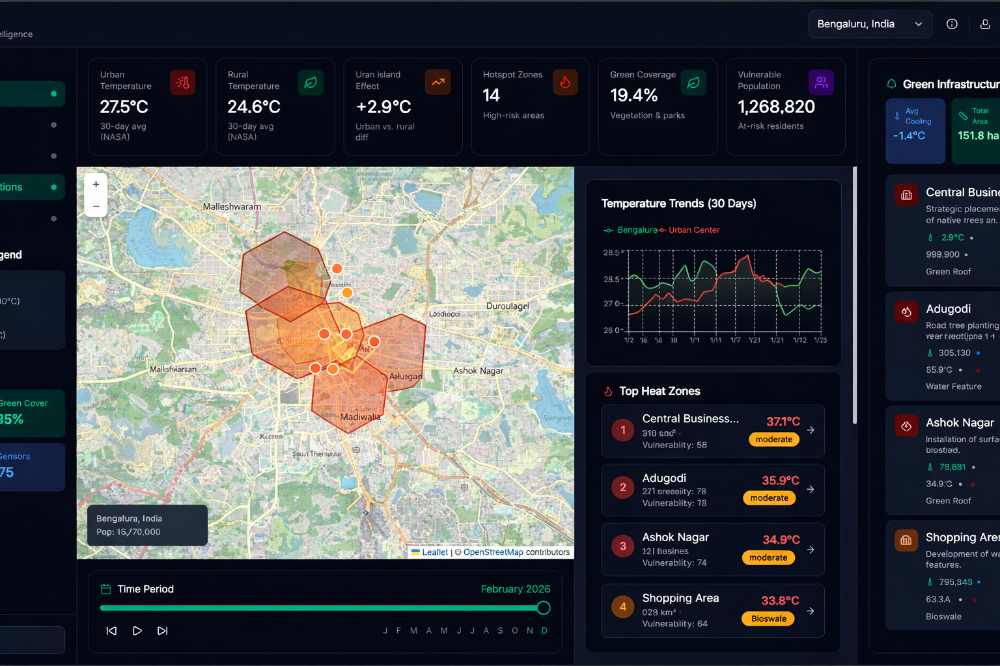

# 🌿 Climora
## 🌍 Climora Dashboard

<p align="center">
  
</p>

### 🌍 Climate Intelligence for Cooler, Healthier Cities

Climora is an AI-assisted urban climate intelligence platform that helps cities identify heat hotspots and implement data-driven cooling strategies. By transforming satellite climate data into actionable insights, Climora empowers planners to build greener, climate-resilient urban environments.

---

## 🚨 Problem

Rapid urbanization and climate change are intensifying **Urban Heat Island (UHI)** effects, exposing cities to extreme heat risks.

This leads to:

- ⚠️ Increased health risks and heat-related illnesses  
- ⚡ Higher energy consumption and cooling costs  
- 🌆 Reduced livability in dense urban neighborhoods  
- 🧓 Greater impact on vulnerable populations  

Current planning tools lack **street-level heat visualization** and **decision support insights**.

---

## 💡 Solution

Climora provides a **data-driven climate dashboard** that:

✅ Detects urban heat hotspots  
✅ Analyzes contributing environmental factors  
✅ Recommends targeted cooling interventions  
✅ Supports climate-resilient urban planning  

---

## 🔥 Key Features

- 🌡️ Urban Heat Island hotspot detection  
- 🗺️ Interactive heat maps & risk zones  
- 🌳 Vegetation & green cover analysis  
- 🏢 Infrastructure density visualization  
- 🤖 AI-assisted cooling recommendations  
- 📈 Temperature trends & impact projections  
- 📍 Sensor & monitoring visualization  
- 🌆 2D & 3D city heat visualization  

---

## 🛰️ Data Sources

Climora integrates reliable open environmental datasets:

- **NASA POWER API** → Satellite temperature data  
- **OpenStreetMap** → Vegetative cover & infrastructure  
- **Urban geospatial data** → Built environment density  

---

## ⚙️ How It Works

1. 📡 Collect satellite temperature data  
2. 🧹 Clean & normalize environmental data  
3. 🔥 Detect heat hotspots & calculate UHI intensity  
4. 📊 Classifies risk severity zones  
5. 🌿 Recommends cooling interventions  
6. 🗺️ Visualizes insights via interactive dashboard  

---

## 🧠 Urban Heat Island Methodology

Climora estimates heat intensity by:

- Measuring temperature at the **urban center**
- Comparing it with a **rural reference point (~50 km away)**
- Calculating:
  This provides a scalable indicator of localized heat stress.

---


## 🏗️ Tech Stack

### 🎨 Frontend
- Next.js 16
- React 19
- Tailwind CSS
- Leaflet & Mapbox GL
- Recharts

### ⚙️ State & Data Handling
- Zustand
- React Query

### 🛰️ Climate Data
- NASA POWER API
- OpenStreetMap

---

## 🖥️ Installation & Setup

### 1️⃣ Clone the repository
```bash
git clone https://github.com/your-username/climora.git
cd climora
npm install
npm run dev
---
